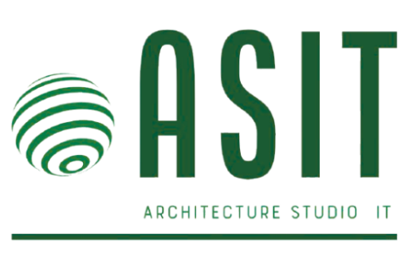

Asit fullstack app


# Overview

**ASIT** *(Architect Studio IT)* is a web-based platform designed to simplify and professionalize IT infrastructure design.

It enables users to design, configure, document, and estimate the cost of complete IT infrastructures within a single, centralized tool. ASIT bridges the gap between visual network design tools, hardware configuration platforms, and budgeting solutions — an intersection that is currently underserved in the market.

ASIT is built around three core pillars:

- Visual Infrastructure Design

- Real-World Hardware Selection

- Automated Budget Estimation & Documentation

The platform is designed to be accessible, sovereign, and compliant with European regulations, while remaining powerful enough for professional use cases.

## Using Commitizen 🛠️
Commitizen helps maintain a consistent commit history by guiding you through the process of writing conventional commits.

### 1. Install Commitizen
```bash
npm install -g commitizen
```
or as a dev dependency:
```bash
npm install --save-dev commitizen
```

### 2. Making commits
Use the `git cz` or `npx cz` command instead of `git commit`:
```bash
git add .
git cz
```
You'll be prompted for type, scope, description, etc.

### 3. Benefits
- **Consistent commit messages** for easy changelog generation.
- Works well with CI/CD and release tooling.

> For more details, visit the [Commitizen project](https://commitizen.github.io/).


## Sources de données

Le catalogue provient d'**Open Icecat** (Open Content License), pas d'un site
marchand scrapé. Voir `icecat/IMPORT_NOTES.md` pour les obligations de licence
et le journal des transformations appliquées.

Mention obligatoire : *Database Right data-sheet [année] Icecat. All rights reserved.*

## Démarrage

Placer `ASIT` et `ASIT-web-scrapper` dans le même dossier, puis lier le fichier
d'environnement de l'application (les variables `ICECAT_*` et `RABBITMQ_*` y sont) :

```bash
ln -s ../ASIT/.env .env
```

1. Créer un compte gratuit sur https://icecat.biz/en/registration et renseigner
   `ICECAT_USER` / `ICECAT_PASSWORD`.
2. Trouver les identifiants de catégories, puis les reporter dans
   `ICECAT_CATEGORIES` sous la forme `server=<id>,switch=<id>,router=<id>,access_point=<id>` :

   ```bash
   docker compose run --rm importer-icecat categories "server|switch|router|access point"
   ```

3. Vérifier le mapping sur un produit réel et ajuster `icecat/mapping.json`
   si besoin — les `Feature.ID` sont déjà renseignés pour les quatre types :

   ```bash
   docker compose run --rm importer-icecat features <icecat_id>   # toutes les features brutes
   docker compose run --rm importer-icecat preview  <icecat_id>   # le message tel qu'il sera publié
   ```

4. Lancer l'orchestrateur (dans l'application, `db-consumer` doit tourner), puis l'import :

   ```bash
   docker compose up -d orchestrator
   docker compose run --rm importer-icecat
   ```

`ICECAT_INDEX=daily` (défaut) ne traite que le delta du jour — quelques fiches.
Pour un premier remplissage, `ICECAT_INDEX=full` parcourt l'index complet
(~1 min de lecture en flux), en commençant par les fiches les plus récemment
mises à jour ; `ICECAT_MIN_UPDATED=AAAAMMJJ` écarte les anciennes et
`ICECAT_MAX_PRODUCTS` borne le volume d'un passage. Les fiches d'une marque
réservée aux revendeurs agréés sont ignorées (code 14) : c'est une limite du
palier gratuit, pas une erreur.

`main.py` propose une petite interface graphique pour lancer les services.

## Dev Team

ASIT is developed by the following team members:

- [Pierre-Etienne HENRY](mailto:pierre-etienne.henry@epitech.eu)
- [Ariles HARKATI](mailto:ariles.harkat@epitech.eu)
- [Ewen LAYLE EVENO](mailto:ewen.layle-eveno@epitech.eu)
- [Dylan ADGHAR](mailto:dylan.adghar@epitech.eu)